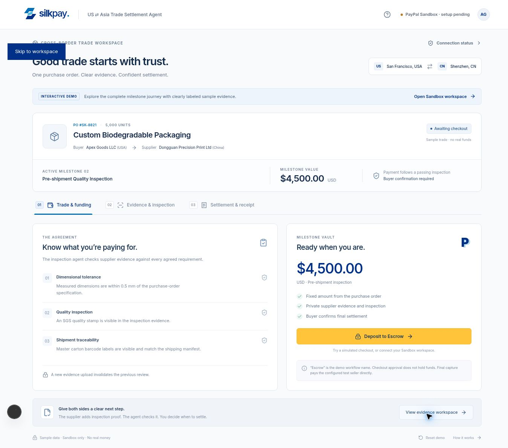
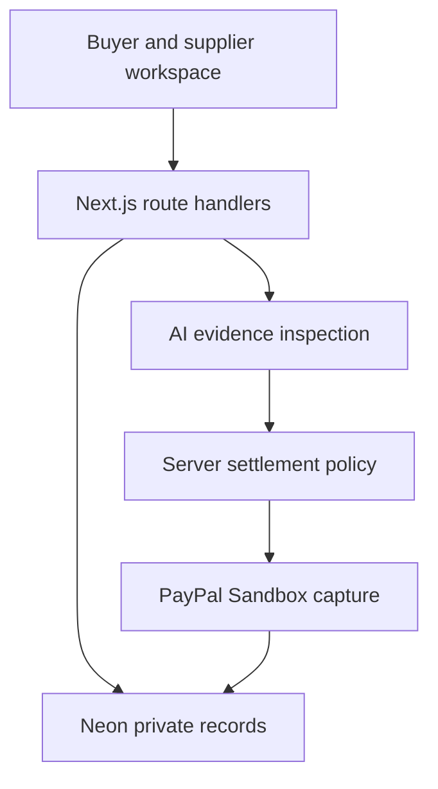

# SilkPay

**US ⇄ Asia Trade Settlement Agent** — a PayPal Sandbox hackathon application for US brands and Asian manufacturers.

[Open SilkPay](https://silkpay-codeup.vercel.app/) · [Source](https://github.com/code-up-matrix/silkpay)

Manufacturing purchase orders often stall because the buyer cannot inspect the goods and the supplier cannot trust that payment will follow. SilkPay ties a fixed payment milestone to explicit acceptance criteria, private supplier evidence, an inspectable AI report, and buyer-confirmed settlement.

The compact three-tab workspace starts with PO **SK-8821**, **5,000 units of custom biodegradable packaging**, buyer **Apex Goods LLC**, supplier **Dongguan Precision Print Ltd**, and a **$4,500 USD pre-shipment inspection**. It checks the 0.5 mm dimensional tolerance, quality stamp visibility and carton barcodes. Additional sample checks compare manifest quantity and shipment weight.



## What is implemented

- Next.js **15.5.28** App Router, TypeScript, React 19, Tailwind CSS 4, Radix/shadcn-style primitives, Lucide icons and locally bundled Inter.
- Responsive **Trade & funding → Evidence & inspection → Settlement & receipt** workspace with keyboard-accessible tabs and dialogs.
- Complete public sample walkthrough: simulated checkout, three downloadable fictional proof fixtures, deterministic inspection, findings and audit log, simulated payout and downloadable JSON receipt. Custom demo files stay in the browser and cannot receive an automatic passing verdict.
- Private buyer workspaces in Neon Postgres; single-use supplier invitations restricted to one purchase order; private PDF/image/text uploads, evidence versions and audit history.
- Server-side PayPal OAuth2, Orders v2 `CAPTURE` creation, verified approval callback, final capture, idempotency and reconciliation. A separate `AUTHORIZE` workflow remains available in `/workspace` for longer-lived holds.
- AI Gateway multimodal inspection of uploaded images, PDFs and reports. Every contract criterion needs cited evidence, confidence ≥95% and no concerns. Provider failure produces an honest held response, not an invented verdict.
- Pending payments remain pending; a genuine Sandbox receipt appears only after a provider-confirmed completed capture. New proof invalidates previous inspection results.
- Tests cover SQL-backed role boundaries, evidence privacy, payment state changes, concurrency, webhook signatures, uncertain inspection, retries and demo isolation.

**Current deployment:** Neon storage is connected with a restricted runtime login. PayPal credentials and the webhook ID still need to be added by the project owner. The public demo works without them. AI Gateway OIDC is configured on Vercel, but a configured identity is not proof of model availability or a completed real review. No live Sandbox capture is claimed in the verification report.

## Payment semantics

“Escrow” and “vault” describe this demonstration's workflow, not regulated custody. With the requested **CAPTURE** intent, buyer approval does **not** reserve, deposit or hold funds. The final capture charges the Sandbox buyer and pays the configured Sandbox seller directly; it is not a separate disbursement or Payouts API call. All suppliers in this demo map to the one configured test seller merchant ID.

The CAPTURE checkout is intentionally limited to a **three-hour demo window**. An expired checkout must be refreshed and its evidence reviewed again. For actual manufacturing lead times, use the retained `AUTHORIZE` flow (29-day authorization validity, with a three-day capture honor-period check and refresh handling) or obtain an appropriate PayPal partner product. See [PayPal order intents](https://developer.paypal.com/whats-an-order/) and [Orders API guidance](https://developer.paypal.com/api/rest/integration/orders-api/api-use-cases/advanced/).

The demo's **96%** score is an explicitly illustrative deterministic result for bundled fixtures. It is not a measured model probability and cannot authorize a PayPal payment. Stamp visibility does not establish SGS certificate authenticity. Uploaded fictional/sample evidence is excluded from actual fulfillment approval by the AI instructions.

## Setup

Use Node.js 24 and npm.

```bash
npm ci
cp .env.example .env.local
npm run dev
```

Open http://localhost:3000. The sample walkthrough needs no credentials. For private workspaces and actual Sandbox APIs, fill these variables locally and in Vercel:

| Variable                       | Purpose                                                                                                                                                                       |
| ------------------------------ | ----------------------------------------------------------------------------------------------------------------------------------------------------------------------------- |
| `APP_ORIGIN`                   | Exact app origin, without a trailing slash. Used for origin checks and checkout/invitation links.                                                                             |
| `DATABASE_URL`                 | Pooled Neon URL for the restricted `app_service` login.                                                                                                                       |
| `DATABASE_URL_UNPOOLED`        | Direct migration-owner URL. Local migration environment only; do not deploy it as the runtime connection.                                                                     |
| `PAYPAL_CLIENT_ID`             | Sandbox REST app client ID; kept on the server by this implementation.                                                                                                        |
| `PAYPAL_CLIENT_SECRET`         | Sandbox REST app secret; server only.                                                                                                                                         |
| `PAYPAL_MERCHANT_ID`           | Configured Sandbox seller merchant ID, verified on every provider order.                                                                                                      |
| `PAYPAL_WEBHOOK_ID`            | Sandbox webhook registration ID for signature verification.                                                                                                                   |
| `NEXT_PUBLIC_PAYPAL_CLIENT_ID` | Optional public identifier for SDK integrations. Included for blueprint compatibility; the redirect checkout does not use it. Never expose the client secret or access token. |
| `AI_GATEWAY_API_KEY`           | Optional Vercel AI Gateway key for local real-AI inspection. Deployed Vercel functions can use OIDC.                                                                          |
| `AI_MODEL`                     | A vision/document/structured-output model available to your Gateway account; current default `openai/gpt-6.1-sol`.                                                            |

Never commit `.env.local`, provider tokens or database passwords. PayPal requests are hardcoded to **https://api-m.sandbox.paypal.com**. No live PayPal host can be selected through a request or environment variable.

### Database

For a fresh Neon database, create a non-admin runtime login and apply `db/001_silkpay.sql` using the migration-owner connection:

```bash
npm run db:migrate
```

Apply `db/002_runtime_grants.sql` as the owner after the `app_service` login exists. It grants application CRUD permissions but only SELECT/INSERT on audit events. The runtime role must not inherit `neon_superuser` or have role/database creation privileges. Do not place its password in a migration or shell history.

The repository's dedicated Neon database was provisioned from the current initial schema, first validated on a separate branch. For an existing installation based on an older schema, use an additive reviewed migration; `CREATE TABLE IF NOT EXISTS` does not upgrade existing columns or constraints.

### PayPal Sandbox

1. Create a **Sandbox** REST app and separate Sandbox buyer and seller test accounts in the [PayPal Developer dashboard](https://developer.paypal.com/dashboard/).
2. Set the app client ID/secret and the intended test seller's merchant ID on the server. Do not use the buyer's merchant ID.
3. Register a Sandbox webhook at `https://YOUR_ORIGIN/api/webhooks/paypal`. Subscribe to the relevant authorization and capture completion/pending/denied/refunded/reversed events. Set `PAYPAL_WEBHOOK_ID` from that registration.
4. Use the configured canonical origin for checkout and supplier invitations. A preview domain needs its own matching `APP_ORIGIN` and isolated test database.
5. Approve checkout using the separate Sandbox buyer. Never enter real account credentials or card details in the demo.

## Demo guide

### Credential-free walkthrough

1. Click **Deposit to Escrow → Simulate checkout approval**.
2. In **Evidence & inspection**, select **Add all samples**. The two PDFs and label image are downloadable and visibly fictional.
3. Run **AI Verification Agent**. Read each finding and expand the inspection audit log. The response identifies the deterministic demo engine.
4. Review settlement, release the milestone and confirm **Complete demo payout**.
5. Download the receipt. It explicitly says the PayPal transaction is **none — simulated demo**.
6. Reset the demo. Try one missing document or add a custom file to demonstrate the held result.

### Actual Sandbox workflow

1. Choose **Open Sandbox workspace**. The fixed example purchase order is stored privately.
2. Approve the checkout in PayPal Sandbox. The server checks the stored amount, currency, milestone and test seller before recording approval.
3. Create a supplier invitation. Open it in a **different browser profile** to preserve the buyer session. The invitation is single-use and expires after seven days.
4. The supplier confirms permission to share evidence with the review service and uploads valid inspection proof. Files are private, capped at six per milestone, with PDFs/images ≤2 MB and UTF-8 text/CSV ≤32 KB.
5. Run the actual AI inspection. Missing, conflicting, fictional or uncertain evidence keeps payout locked. If the provider is unavailable, evidence remains saved and the report explains that payout is held.
6. Return as buyer, examine the findings and confirm **Release Milestone Payout**. A completed PayPal capture ID appears only after confirmation by PayPal.
7. Use **Refresh PayPal status** after a timeout or pending result. Retries reuse the same operation-specific idempotency key.

Opening an invitation in the buyer's browser replaces that browser's buyer cookie. Workspace sessions expire after seven days and are intended for this Sandbox demonstration; production identity, account recovery and organizational access management are not implemented.

## Architecture and API



| Endpoint                             | Responsibility                                                                                                                                                                        |
| ------------------------------------ | ------------------------------------------------------------------------------------------------------------------------------------------------------------------------------------- |
| `POST /api/workspace`                | Create a private buyer workspace and HttpOnly session.                                                                                                                                |
| `GET /api/workspace`                 | Load scoped records or public sample data.                                                                                                                                            |
| `POST /api/orders/seed`              | Idempotently create the blueprint PO in the current workspace.                                                                                                                        |
| `POST /api/paypal/create-order`      | `{ milestoneId, accepted: true }` → server-priced CAPTURE checkout URL.                                                                                                               |
| `POST /api/paypal/approve-order`     | `{ milestoneId, orderId }` → verify approval directly with PayPal.                                                                                                                    |
| `POST /api/paypal/capture-order`     | `{ milestoneId, orderId }` → capture only a current passing review with buyer authority.                                                                                              |
| `POST /api/agent/verify`             | `{ mode: "demo", fixtures, unknownFiles? }` or authenticated `{ mode: "sandbox", milestoneId }`. Returns `verified`, `score`, `findings`, `readyForPayout`, `engine` and audit steps. |
| `POST /api/invitations`              | Create a scoped, single-use supplier link.                                                                                                                                            |
| `POST /api/invitations/join`         | Consume the supplier token and establish scoped access.                                                                                                                               |
| `POST /api/milestones/:id/evidence`  | Private multipart supplier upload with explicit review consent.                                                                                                                       |
| `GET /api/evidence/:id`              | Authorized attachment download only.                                                                                                                                                  |
| `POST /api/milestones/:id/reconcile` | Retrieve and reconcile provider payment state.                                                                                                                                        |
| `POST /api/webhooks/paypal`          | Verify the complete event signature before reconciliation.                                                                                                                            |
| `GET /api/health`                    | Configuration booleans; not a deep provider availability check.                                                                                                                       |

`lib/paypal.ts` exports `getPayPalAccessToken()`, `createOrder(amountInCents, currency, context)`, and `captureOrder(orderId, milestone)`. The extra server-side context binds a provider request to the exact saved milestone and supplier merchant. Browser prices, client verdicts and arbitrary URLs are rejected.

Evidence reviews and captures use database leases. Evidence versions prevent an old review from releasing a newly changed shipment. Audit records distinguish provider confirmation, pending outcomes, supplier uploads and buyer instructions. Sessions and invitation tokens are stored as SHA-256 hashes; cookies are HttpOnly/SameSite and Secure in production. Mutating requests require the configured origin. Binary upload signatures and private download scopes are checked server-side.

## Validation

```bash
npm run typecheck
npm test
npm run build
```

The 61 automated tests use isolated PostgreSQL-compatible PGlite and explicit PayPal/AI test doubles. They do not prove a live provider transaction. `scripts/smoke.mjs` can explicitly exercise a deployed database-backed workspace without calling PayPal or an AI model:

```bash
SILKPAY_BASE_URL=https://YOUR_ORIGIN node scripts/smoke.mjs
```

This creates fictional smoke-test records, verifies private upload/download and invitation isolation, then revokes the test sessions. It never deletes user data or prints invitation/session secrets. See [verification notes](docs/VERIFICATION.md) for observed checks and remaining limits.

## Vercel deployment

Import this repository into Vercel as a **Next.js** project. Use Node.js 24, `npm ci`, and `npm run build`; no custom adapter is required. Keep the function region near Neon (the existing deployment uses Frankfurt). Add sensitive server variables through Vercel Project Settings, set `APP_ORIGIN` to the production domain, and redeploy. AI Gateway availability depends on the account's model access and usage allowance.

Production build output is `.next`; local preview uses `.next-dev` so a build does not corrupt the running development server. The dev wrapper accepts the managed preview host/port flags as well as ordinary `npm run dev`.

The existing deployment is `https://silkpay-codeup.vercel.app/`. GitHub Actions runs type checks, tests and a production build. Publication in this workspace uses the connected GitHub and Vercel accounts; automatic deployment on every future Git push still depends on the repository's Vercel Git integration being connected.

## Scope

This is a deployable, guarded **Sandbox MVP**, not a regulated escrow or production money-transfer service. It does not implement real-money custody, independent certificate authentication, supplier onboarding/merchant verification, production identity recovery, multi-merchant payouts or compliance approval. PayPal credentials, webhook configuration and an actual two-account Sandbox payment rehearsal remain owner setup steps. A hackathon submission and judging eligibility are not claimed by this repository.
